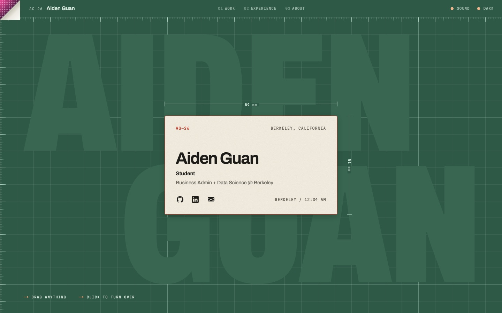
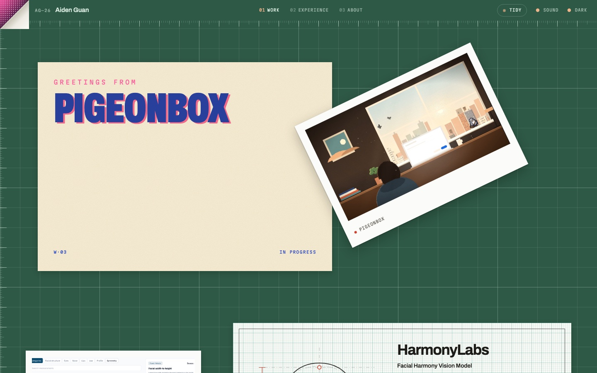
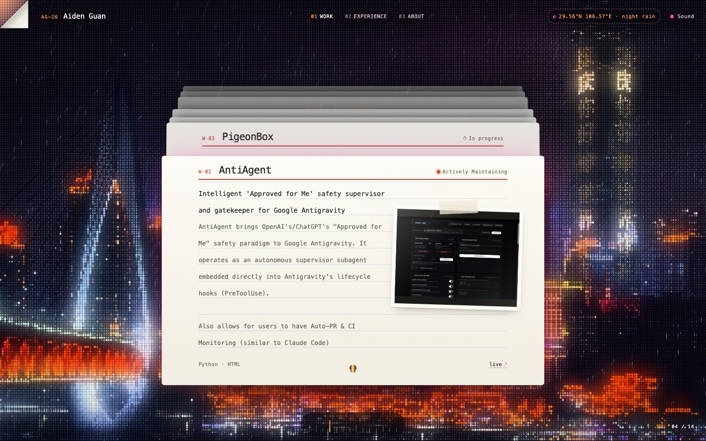
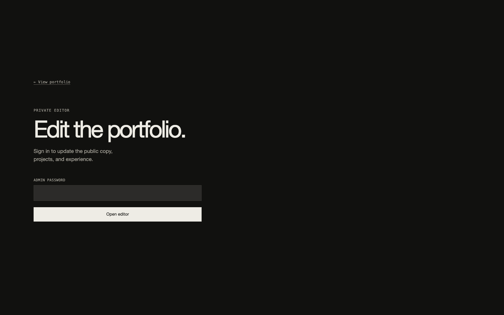

<div align="center">

# Aiden Guan — The Cutting Mat

**A portfolio laid out as printed things on a self-healing cutting mat, to pick up, throw, turn over, tear, punch, cut and burn, with a private headless CMS, made with Next.js 16, React 19, TypeScript, and Cloudflare R2 storage.**

[Live Site](https://aidenguan.com) · [Architecture](#system-architecture) · [Admin CMS](#private-headless-cms-admin-editor) · [Engineering Deep Dives](#engineering-deep-dives) · [Quick Start](#getting-started)

<br/>

[](https://aidenguan.com)
[](https://nextjs.org/)
[](https://react.dev/)
[](https://www.typescriptlang.org/)
[](LICENSE)

<br/>



</div>

---

## Overview

This repository powers **[aidenguan.com](https://aidenguan.com)**, the personal index of Aiden Guan (studying Business Administration and Data Science at UC Berkeley).

The portfolio is a designer's cutting mat with the work laid out on it, knolled square to the grid. The name is printed into the mat; a business card lies across it. Every project is printed as the thing its own idea suggests: a sneaker-reselling business is a till receipt (its revenue on the TOTAL line), an approval gatekeeper is a stamped carbon form, an email client is a postcard, a hackathon win is a ticket with a stub to tear off, Continuity is an agent routing slip, and CourtVision is a basketball scouting diagram with a drawing title block. Roles are punch-clock time cards; notes are an index card; contact is an envelope.

Everything on the mat can be picked up. The point you hold stays under the pointer and the sheet swings about it the way paper does, slides to a stop when thrown, and turns over on a click. Tickets punch, time cards clock in at the current Berkeley time, the envelope is postmarked before it opens an email, and **Tidy** squares everything back up. Wherever a thing was taken from, crop marks stay printed on the mat, and a thing set down near them is pulled square onto them.

The mat itself is a self-healing one, so it can be cut. Over the bare mat the pointer is a blade; drag it and a craft knife, drawn to scale, comes down and opens a hairline cut that reads off its length in millimetres, then closes up behind the blade from where it began, like a zip, and fades. Shift lays a straight edge. Once a visit the knife shows how, by underlining the hint that says to cut. The knife cuts whatever is on the mat too: drawn right across a sheet, it parts it in two along the line it took, and each piece moves on its own. Pick up the torch instead and it browns, chars and burns through paper, and scorches the mat; Tidy brings every piece home and mends it. The rulers along the top and down the side follow the pointer, and the extent of whatever is held, the way a drawing program's do. Each thing is plain HTML in reading order; the physics is only transforms on top.

Behind the mat is a private, authenticated in-browser CMS. Content edits and project media publish instantly to production via Cloudflare R2 object storage with zero build latency, zero egress fees, and zero redeployment requirements.

### Four ways in

The front page is black, with one sentence on it: *Hi, my name is Aiden and I am a ___.* The blank rolls through four answers, each set in the face of the page it leads to; hover or tap it to see all four and pick one. The page you pick washes in from the word.

| Route | What it is |
| :--- | :--- |
| `/student` | The cutting mat described above, unchanged. |
| `/founder` | **ClockedIn**: the work history as a LinkedIn profile, with posts, honors and endorsements. |
| `/builder` | Every build as a thumbnail; a thumbnail opens into the full story. |
| `/designer` | A pixel-art island, rendered live in WebGL: LedgerLens's tree on the hill and its koi pond below, Continuity's bridge and the thread of letters across it, Seyrin's mailbox, Rally's table, CourtVision's court, PigeonBox's dovecote, alai's chalkboard, BarkOff's corgis. Click anything to open it. It turns to night after 8pm local time. |

Everything outside the mat reads from [`content/worlds.ts`](content/worlds.ts) (projects, thumbnails in `public/projects/`) and [`content/founder.ts`](content/founder.ts) (the profile). The island is drawn at a low resolution and scaled up by whole device pixels: voxel models lit by a late sun, then a post pass that dithers colour down to a few levels, rims solid things in a darker line, and dissolves the ground's edge into the paper.

---

## Core Capabilities

| The Mat | Scenery Versions |
| :--- | :--- |
|  |  |
| **Things With Weight**: Each project is printed as its own object (receipt, stamped form, postcard, measured drawing, ticket) with its photos and films beside it. Grab anything by any point and it swings about your hand; throw it and it slides; click to turn it over; tear the ticket's stub, punch it, clock in on a time card; drop it near its crop marks and it seats; Tidy knolls it all back. Cut the mat and it heals; cut the paper and it comes apart; burn it with the torch. Films play while they're in view; a print opens full size. | **Postcards to Another World**: Four animated dot-"ascii" scenes live on the postcards in What I’m Exploring: click one and the mat becomes that place; click it again to come home. The paper stays paper, lying on the scene, and the printed name is redrawn in the scene's own dots. |

| Private In-Browser Headless CMS | Zero-Flicker Theme Engine |
| :--- | :--- |
|  | **Instant Dark / Light Adaptation**: Zero-dependency inline `<head>` script evaluates `localStorage` and OS `prefers-color-scheme` before the DOM paints, eliminating theme flash (FOIT) without layout shift. Dark mode swaps the green mat for the black one. |
| **Zero-Redeploy Publishing**: Dedicated `/admin` route protected by cryptographic session tokens. Allows full editing of profile copy, social links, section titles, project details (including what each project is printed as on the mat), the recent photos pegged on the clothesline, and asset uploads directly to Cloudflare R2 with pre-signed size validation and hard storage blockers. | **Edge Social Generation**: Dynamically generates high-resolution Open Graph image cards via `@vercel/og` with automatic sitemap generation and canonical metadata routing. |

---

## Arcade

Scrolling past the final envelope fractures the print into a CRT monitor. Domain-warped pixel erosion grows from the viewport edges, shifts over time, and bends around the pointer. The final card splits into horizontal tears and displaced fragments before the monitor expands.

The arcade expands the original green CRT and pixel-portrait style into three levels. Each level has three NPC waves and a protected boss entrance. Level one keeps Guan’s human, catboy, and evil forms, including the pink sparkles, meow, red eyes, scar, and mechanical ascension rings.

| Level | Boss | Appearance and attacks |
| --- | --- | --- |
| 01 · Guan | Original human → catboy → evil encounter | Original portrait sampling, green phosphor, pink ears/blush, crimson eyes/scar, crossfire, curved hearts, marked traps, rotating beams, and summoned guards |
| 02 · Phoebe | Phoebe | Supplied photo rendered on the same pixel grid, warm tortilla tones; Fetch → Pack Instinct → Zoomies, returning bones, paw traps, howl gaps, lunges, and mini cat-ear Guan echoes |
| 03 · The Co-Founder | Allen | Supplied portrait in the established crimson palette, three-phase clone fight, animated cutout hand seals, destructible copies, an armored core, interruptible clone lasers, and prism crossfire |

- **Choose a ship:** Kestrel fires twin ion lances; Helix fires a plasma fan and guided torpedoes; Wraith chains lightning across nearby targets, losing 55% damage with each jump. Hold Shift or toggle Focus for precision movement and each hull's focused weapon. Wraith's focused rail pierces multiple targets. Change hull with 1/2/3 or the ship-name button during flight, with a three-second swap cooldown. Kestrel handles faster; Helix handles more slowly; Wraith trades range for automatic arcs.
- **Fly:** WASD, arrows, or an anchored drag. Weapons fire automatically. Four hull points, rare repair drops, and one point of repair between sectors. Boss phase changes do not heal the player; summoned enemies cannot farm repairs.
- **Enemies:** Palantir drones and articulated Anduril walkers provide ranged fire. Mini Elon rushers mark a destination before charging. Peter Thiel units lock twin eye-laser paths before firing; destroying a unit interrupts its beams.
- **Dash:** Space or Dash grants a bounded invulnerable burst. Passing through shots absorbs them for score and overdrive. Dash recovery is 2.6 seconds; one dash can damage each melee unit only once.
- **Pulse:** X, right click, or Pulse releases a local EMP. It clears nearby projectiles and damages units inside the expanding ring, with a fixed 20-second cooldown.
- **Overdrive:** close dodges, absorbed shots, kills, and pickups charge 4.5 seconds of reinforced fire. Dealing boss damage does not charge it. The gold energy meter shows it.
- **Replay:** a best score for the new balance rules (previous scores are retained in their old storage key), elapsed time, close dodges, and an S–C clear rank. A death in a boss fight checkpoints the current phase, so its retry skips the waves; wave deaths retry the sector. Continues incur a 40% score penalty and a maximum B rank. You can also restart the campaign.
- **Pause/exit:** P or Pause; switching tabs pauses automatically. Escape restores the portfolio. Sound follows the portfolio's Sound setting.
- **Reduced motion:** explicit entry replaces the scroll takeover and edge effects. Background drift, ship bobbing, camera shake, and dash trails are suppressed; combat warnings remain visible.

The browser adapter (`arcade.ts`), deterministic simulation (`campaign.ts`), hangar catalog (`catalog.ts`), audio, and canvas renderer (`campaign-vfx.ts`) are separate. Flight runs at 120 simulation steps per second and projectiles use swept collisions. Portrait variants and glow sprites are cached; projectiles and bursts have bounded counts. Boss photographs are optimized WebP assets, loaded when the arcade opens. The rest of the portfolio keeps the game engine behind a dynamic import.

`npm run test:arcade` checks all nine boss stages, protected phase gates, hand-seal timing, clone armor and interruption, minion caps, damage budgets, dash/swap exploits, area-warning collisions, resize behavior, campaign progression, audio cleanup, and flight/input regressions. Progression tests use damage immunity to isolate state transitions; combat benchmarks use normal damage and movement.

`npm run balance:arcade` regenerates [the measured balance data](docs/arcade-balance.json): actual projectile damage after travel/warmup, plus 162 isolated boss-phase trials across three hulls, two viewport widths, and stationary/strafe/threat-aware policies. The aware policy makes four decisions per second. It is a deterministic regression check, not a claim of human playtesting. [The encounter and balance notes](docs/arcade-balance.md) explain the mechanics and measurement limits. Visuals are reviewed separately in the local browser.

## System Architecture

The project operates across a dual-surface architecture separating public visitor presentation from authenticated content persistence.


### End-to-End Workflow

1. **Request Intake**: Incoming requests to `aidenguan.com` hit the Next.js App Router (`app/page.tsx`).
2. **Content Resolution**: `getPortfolioContent()` checks for configured Cloudflare R2 credentials (falling back to legacy Vercel Blob or typed schema defaults in `content/portfolio.ts`). If present, it retrieves the live private `portfolio/content.json` document with a 60-second cache-control window.
3. **Payload Sanitization**: Payloads pass through `parsePortfolioContent()`, which validates all strings, arrays, safe URI protocols (`http:`, `https:`, `mailto:`), and bounds check text lengths.
4. **DOM Painting & Theme Application**: An inline script in `<head>` applies `dataset.theme` prior to paint. The server renders the mat as plain HTML (`components/mat/mat.tsx`): the printed name and business card, then a band per section, with each project printed as the thing `projectKind()` in `lib/mat.ts` picks for it (or the editor's choice), its prints beside it.
5. **Picking Things Up**: The client `Table` (`components/mat/table.tsx`) measures where CSS put each thing and adds only an offset and a turn on top, as transforms. A held sheet keeps the held point under the pointer and swings about it under the mat's drag; let go, it slides to a stop, or seats onto its crop marks if it stops near them. Clicks turn things over, punch tickets, clock in, open prints in the print viewer, frank the envelope, or travel to a scene; Tidy springs everything home.
6. **Cutting the Mat**: A press on the bare mat goes to `lib/cuts.ts` instead: the knife (`components/mat/knife.tsx`) comes down at the pointer, the cut is recorded in mat coordinates and drawn into a canvas that scrolls with the mat, and it heals on its own clock. Every point of the blade's path is also handed to the table, which cuts the paper under it (`lib/wear.ts`) and parts a sheet the blade goes right across.
7. **Burning**: With the torch in hand (`components/mat/tools.tsx`), a press anywhere on the mat goes to `lib/torch.ts`, which asks the table to heat whatever is uppermost under the flame each frame, scorches the bare mat, and draws the flame, smoke and sparks over everything.
8. **Authenticated Publishing**: When the maintainer accesses `/admin`, credentials authenticate against SHA-256 session cookies. Updated JSON documents write atomically to Cloudflare R2 via `savePortfolioContent()`. Direct media uploads stream straight to R2 via S3 presigned URLs with exact `ContentLength` verification and storage quota checks, updating public visitor traffic immediately.

---

## Private Headless CMS & Admin Editor

The repository integrates a full-featured content management suite under `app/admin/`:

- **Session Security**: Session tokens are cryptographically derived via SHA-256 hashes of the admin password paired with HTTP-only, secure, `SameSite=Strict` cookies (`lib/admin-auth.ts`).
- **Input Validation**: Strict parser contracts (`lib/portfolio-content.ts`) reject malformed JSON, enforce maximum character lengths, restrict URL schemes to safe web protocols, and sanitize image pathnames.
- **Media Upload Pipeline**: Client-side byte sniffing (`lib/portfolio-media.ts`) verifies magic signatures for JPEG, PNG, WebP, GIF, AVIF, MP4, WebM, and MOV formats. Direct uploads use S3 presigned URLs with enforced `ContentLength` headers, bypassing serverless request body limitations.
- **Storage Guard & Hard Blocker**: Real-time bucket monitoring (`lib/r2-limits.ts` & `components/admin-storage-guard.tsx`) enforces a 5 GB hard ceiling (well within Cloudflare's 10 GB free tier) and a 1,000-file quota, blocking accidental overages before bytes reach cloud storage.
- **Local Development Proxy**: When running locally without active cloud credentials, `app/api/media/[name]/route.ts` proxies remote media directly from `aidenguan.com` with HTTP 206 byte-range streaming support.

---

## Engineering Deep Dives

### 1. Zero-Egress Cloudflare R2 Storage with Hard Quota Blockers and Byte-Range Streaming

- **Problem**: Cloud object storage risks surprise billing or accidental overages from runaway video uploads and egress fees. Traditional serverless upload routes also fail against body size ceilings (e.g. 4.5 MB), and browser video playback on iOS/Safari stutters without HTTP 206 byte-range seeking.
- **Approach**: Transitioned persistence to Cloudflare R2 via `@aws-sdk/client-s3` ($0 egress fees, 10 GB free tier). Implemented a multi-tier safety architecture: pre-upload quota checks (`lib/r2-limits.ts` with 5 GB hard ceiling and 1,000 file caps), presigned S3 URLs locking exact `ContentLength` headers, HTTP 206 Range request proxying (`app/api/media/[name]/route.ts`) for video scrubbing, and an automated CLI management suite (`scripts/manage-r2.mjs`).
- **Why**: Delivers fast video playback and zero-rebuild publishing while guaranteeing that accidental bandwidth or storage spikes can never incur cloud bills.
- **Tradeoff**: Single-document persistence uses atomic put overwrites optimized for a single author. Concurrent administrative sessions rely on last-write-wins semantics.

### 2. Paper Physics on Plain HTML That Stays Readable, Accessible and Smooth

- **Problem**: A physical-object portfolio tends to trade away the things a portfolio needs: readable type, keyboard and screen-reader access, native scrolling, and a steady frame rate.
- **Approach**: Every thing is server-rendered HTML in reading order, laid out by CSS in millimetres of mat (`--u`), so a business card is a business card's size next to a receipt. `components/mat/table.tsx` adds only a translate and a rotation per thing. A held sheet is a rigid body pinned at the held point: the mat's drag acts at its middle, and the torque about the pin swings the sheet into line behind the hand; released, it keeps its velocity and spin under sliding friction. Styles are written only when they change, things get their own compositor layers only while they move, and a ticket's stub is a second body joined to the ticket until it is pulled past its tear strength.
- **Why**: Keeps the page a document (scrollbar, find-in-page, links in tab order, every thing focusable: Enter turns it over or acts, arrow keys nudge it) while giving it weight; reduced motion keeps the drag and drops the momentum and animation.
- **Tradeoff**: Text that runs long makes a thing taller rather than smaller; fixed-shape things (business card, postcard) hold their proportions on wide screens and grow to fit on phones.

### 3. A Self-Healing Cut That Never Swims

- **Problem**: A cut has to look carved into the mat (a slit with a lit lip, not a stroke on top), heal visibly along its own length, stay locked to the mat while the page scrolls, pass under the paper and over the mat's print, and cost nothing once it has healed.
- **Approach**: `lib/cuts.ts` records each cut as points in mat coordinates, each with the time the blade passed and the time it starts to close, which runs along the cut at a minimum speed so even a flick closes from its start like a zip. Every frame the slit is drawn per stretch: a faint healed line, a lighter lower lip, then the groove, each run of points that look alike stroked once. The canvas sits inside the mat, just over its print and under every thing, and reaches a third of a window above and below the view, so it scrolls natively with the mat and is only moved and redrawn when the view nears its edge; once everything has healed it gives its backing store back. The knife is an SVG drawn in millimetres with its tip at the origin, so it is to scale on every screen; its shadow is sheared along its length, since the tip is on the mat and the handle is not.
- **Why**: Cutting is the one thing a cutting mat is for, and healing is the one thing this kind does; a canvas fixed to the window would trail a frame behind native scrolling, and a canvas the height of the page would cost tens of megabytes.
- **Tradeoff**: Cuts are decoration and are not kept: they heal in a few seconds, and a reload leaves the mat whole. There is no mat under a scenery version, so there is nothing to cut there.

### 4. Paper That Comes Apart and Burns

- **Problem**: A sheet on the mat is real HTML (links, text, a film), not a picture of one, yet a cut has to part it along the exact line the blade took and a flame has to burn holes through it, on both faces, while it can still be dragged, thrown and turned over, and all of it has to be undone by Tidy.
- **Approach**: `lib/wear.ts` keeps a sheet's damage in its own frame: its outline, ragged holes, a millimetre grid of char and its slits. The outline less the holes (by `polygon-clipping`) becomes an even-odd `clip-path: path()` on each face, mirrored for the back, and on the box it turns in, so only paper catches the pointer. The table parts a sheet by cloning it, laying the clone exactly over it and giving each one side of the cut; each piece turns about the middle of what's left of it, shifted so nothing moves on screen. The char is a small image upscaled and multiplied into the paper; slits and glowing edges are drawn over it.
- **Why**: Clipping the real element keeps its print crisp at any size and keeps everything working on the pieces, at the cost of only a canvas or two per damaged sheet.
- **Tradeoff**: A piece is a copy, hidden from assistive technology, so the page is read once, whole. Damage isn't kept: Tidy or a reload undoes it.

### 5. Zero-Hydration-Flash Dark & Light Theme Architecture

- **Problem**: React App Router components hydrating asynchronously often cause a bright white flash when a visitor has selected dark mode (FOIT) if theme state is resolved within `useEffect`.
- **Approach**: Injected an inline script block directly inside `app/layout.tsx` `<head>` before any body elements render. The script synchronously evaluates `localStorage.getItem('aiden-theme')` or system `window.matchMedia('(prefers-color-scheme: dark)')` and stamps `data-theme` directly onto `document.documentElement`.
- **Why**: Completely prevents visual theme flashing during page load without adding third-party theme package weight.
- **Tradeoff**: Requires `suppressHydrationWarning` on the root `<html>` tag to prevent React hydration mismatch warnings.

---

## Technology Stack

### Client & Presentation
- **Framework**: Next.js 16.3.4 (App Router, Server Components)
- **UI Runtime**: React 19.2.8
- **Typography & Styling**: Archivo (variable width), Martian Mono, Doto (dot-matrix) and Libre Barcode 128 via `next/font`; CSS custom properties sized in millimetres of mat; CSS 3D for turning things over; 2D canvases for the cuts, the scorch and the flame; `polygon-clipping` for what's left of a cut or burnt sheet; and a few kilobytes of Web Audio for paper foley (slides, landings, tears, punches, the blade, a postmark, the torch)
- **Media Optimization**: Next.js Image component with responsive sizing and layout containment

### Server & Route Handlers
- **API Handlers**: Node.js route handlers (`app/api/admin/*`, `app/api/media/*`)
- **Metadata Engine**: Dynamic OpenGraph generation (`@vercel/og`), dynamic `sitemap.xml`, and `robots.txt`
- **Domain Routing**: Centralized canonical URL resolver (`lib/site-url.ts`) prioritizing `aidenguan.com`

### Persistence & Storage
- **Document Store**: Cloudflare R2 S3-compatible private bucket (`portfolio/content.json`) with legacy Vercel Blob fallback
- **Media Object Store**: Cloudflare R2 private bucket with zero egress fees (`portfolio/media/*`)
- **Video & Media Streaming**: HTTP 206 byte-range streaming with public CDN redirect support
- **Storage Safety**: In-memory quota cache, hard cap blockers (5 GB safety ceiling), and S3 signed content-length verification

### Security & Authentication
- **Session Verification**: SHA-256 cryptographic message hashing with HTTP-only cookies
- **MIME & Byte Verification**: Magic-byte signature checking for image and video uploads
- **Sanitization**: Strict length bounding and URL protocol whitelist validation

---

## Getting Started

### Prerequisites
- Node.js 20.x or higher
- npm (v10 or higher)

### Quick Start

1. **Clone the repository**:
   ```bash
   git clone https://github.com/aiden-guan/portfolio-2.git
   cd portfolio-2
   ```

2. **Install dependencies**:
   ```bash
   npm install
   ```

3. **Configure local environment**:
   ```bash
   cp .env.example .env.local
   ```

4. **Launch development server**:
   ```bash
   npm run dev
   ```
   Open [http://localhost:3000](http://localhost:3000) in your browser. The site will boot with typed default content and proxy remote images from production.

---

## Configuration & Environment Variables

| Variable | Required | Description |
| :--- | :---: | :--- |
| `NEXT_PUBLIC_SITE_URL` | Optional | Canonical site origin (defaults to `https://aidenguan.com` in production and `http://localhost:3000` in dev). |
| `ADMIN_PASSWORD` | Optional | Shared password required to authenticate into the `/admin` editor portal. |
| `R2_ACCOUNT_ID` | Optional | Cloudflare account identifier for R2 bucket access. |
| `R2_ACCESS_KEY_ID` | Optional | S3-compatible access key ID for Cloudflare R2. |
| `R2_SECRET_ACCESS_KEY` | Optional | S3-compatible secret access key for Cloudflare R2. |
| `R2_BUCKET_NAME` | Optional | Name of the R2 bucket (defaults to `portfolio-media`). |
| `R2_PUBLIC_URL` | Optional | Custom domain or public R2 URL for direct CDN asset serving. |
| `R2_MAX_STORAGE_GB` | Optional | Hard safety threshold in GB before uploads are blocked (defaults to `5`). |
| `R2_MAX_FILES` | Optional | Maximum number of objects allowed before blocking uploads (defaults to `1000`). |
| `GITHUB_TOKEN` | Optional | A GitHub token for the projects folder's hourly read of public repos (a fine-grained token with no permissions is enough). Without it GitHub allows 60 requests an hour per server address, which a shared address can run out of; the folder then shows its built-in list. |
| `BLOB_READ_WRITE_TOKEN` | Optional | Legacy access token for Vercel Blob migration fallback. |

---

## Repository Structure

```text
portfolio-2/
├── app/
│   ├── admin/               # Private in-browser CMS editor portal (/admin)
│   ├── api/
│   │   ├── admin/           # Authenticated session, content, media, and quota API handlers
│   │   └── media/[name]/    # Secure media streaming route with HTTP 206 Range & dev proxy
│   ├── globals.css          # Core design tokens, links, print viewer, admin editor
│   ├── layout.tsx           # Root layout, fonts, zero-flicker theme script, and canonical metadata
│   ├── mat.css              # The mat and everything on it: stocks, inks, stamps, prints, rulers
│   ├── opengraph-image.tsx  # Dynamic 1200x630 OpenGraph card generation via @vercel/og
│   ├── page.tsx             # The black page: "Hi, my name is Aiden and I am a ___"
│   ├── student/page.tsx     # Masthead and the mat, built from the live content
│   ├── founder/             # ClockedIn, the LinkedIn-style profile
│   ├── builder/             # The builds gallery
│   ├── designer/            # The pixel island
│   ├── scenery.css          # Scenery versions and legacy page-turn styles
│   ├── robots.ts            # Dynamic robots.txt generation
│   └── sitemap.ts           # Dynamic sitemap.xml generation
├── assets/
│   ├── fonts/               # Static font instances for the generated sharing image
│   └── readme/              # High-resolution README presentation assets
├── components/
│   ├── admin-editor.tsx     # Full reactive admin editor form interface
│   ├── admin-image-editor.tsx # Direct presigned media uploader & format validator
│   ├── admin-storage-guard.tsx # Visual storage quota gauge & 1-click orphan cleaner
│   ├── local-time.tsx       # Live-updating Berkeley time calculation
│   ├── mat/
│   │   ├── mat.tsx          # The mat from the live content: name, card, a band per section
│   │   ├── things.tsx       # Business card, receipt, form, postcard, drawing, ticket, time card, envelope, prints
│   │   ├── table.tsx        # Picking things up: paper physics, turning over, tearing, punching, crop marks, rulers, Tidy
│   │   ├── knife.tsx        # The craft knife, drawn to scale, and the layer the cuts are drawn on
│   │   ├── torch.tsx        # The pocket torch, drawn to scale, and the layers the flame and scorch are drawn on
│   │   ├── tools.tsx        # Knife or torch: what's in hand
│   │   ├── places.tsx       # Living postcards of the scenery versions, which travel there
│   │   └── wordmark.tsx     # The name printed into the mat, fitted to it
│   ├── print-viewer.tsx     # Full-size viewer for the prints and films on the mat
│   └── scenery.tsx          # Scenery backdrops and dot-printed name
├── content/
│   └── portfolio.ts         # Schema definitions, type guards, and fallback content
├── lib/
│   ├── admin-auth.ts        # SHA-256 session token generation and cookie management
│   ├── media-limits.ts      # Media size boundaries and MIME definitions
│   ├── portfolio-content.ts # R2/Blob retrieval, payload parsing, and validation guards
│   ├── portfolio-media.ts   # Magic-byte file validation and media helpers
│   ├── r2.ts                # S3-compatible Cloudflare R2 client and presigning utilities
│   ├── r2-limits.ts         # Storage quota guard, bucket counter, and hard limit blocker
│   ├── mat.ts               # What each project is printed as, stamps, barcodes, periods
│   ├── cuts.ts              # Cutting the mat: the blade, the cut, and how it heals
│   ├── wear.ts              # What a knife and a flame do to paper: outline, holes, char, slits
│   ├── torch.ts             # Burning: the flame, smoke, sparks, ash and the mat's scorches
│   ├── riffle.ts            # Synthesised paper foley (slide, land, turn, tear, punch, blade, postmark, torch) and its switch
│   ├── scenery/             # Dot-field renderer and the four scenery versions
│   └── site-url.ts          # Canonical site origin resolver
├── scripts/
│   ├── manage-blobs.mjs     # Legacy Vercel Blob inspection and migration utility
│   ├── manage-r2.mjs        # Cloudflare R2 storage inspector, orphan cleaner & abort tool
│   ├── test-hard-blocker.mjs # Integration test verifying quota rejection behavior
│   └── test-r2.mjs          # End-to-end R2 upload, fetch, and range verification
├── public/                  # Static web manifests and icons
├── LICENSE                  # MIT License
└── package.json             # Scripts and dependencies
```

---

## Verification & Quality Checks

Run the automated verification suite:

```bash
# Run ESLint validation
npm run lint

# Run TypeScript typecheck
npm run typecheck

# Execute production build
npm run build
```

---

## Status & Limitations

- **Maturity**: In active production use at [aidenguan.com](https://aidenguan.com).
- **Concurrency**: Storage uses single-document atomic overwrite semantics; concurrent administrative editors are not synchronized in real-time.
- **Media Storage**: Primary persistence is powered by Cloudflare R2 with $0 egress and 10 GB free tier storage, protected by an automatic 5 GB safety blocker. In local development without credentials, media requests proxy directly from `aidenguan.com`.

---

## License

This project is licensed under the MIT License — see the [LICENSE](LICENSE) file for details.
