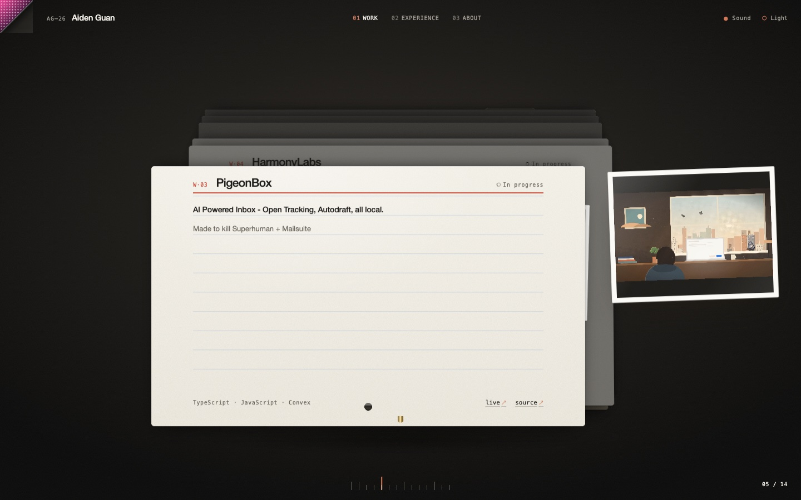
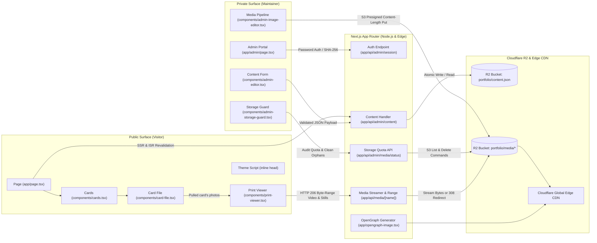

<div align="center">

# Aiden Guan — The Card File

**A portfolio built as a physical index-card file, with a private headless CMS, made with Next.js 16, React 19, TypeScript, and Cloudflare R2 storage.**

[Live Site](https://aidenguan.com) · [Architecture](#system-architecture) · [Admin CMS](#private-headless-cms-admin-editor) · [Engineering Deep Dives](#engineering-deep-dives) · [Quick Start](#getting-started)

<br/>

[](https://aidenguan.com)
[](https://nextjs.org/)
[](https://react.dev/)
[](https://www.typescriptlang.org/)
[](LICENSE)

<br/>


</div>

---

## Overview

This repository powers **[aidenguan.com](https://aidenguan.com)**, the personal index of Aiden Guan (studying Business Administration and Data Science at UC Berkeley).

The site takes the word *index* literally. The portfolio is an index-card file: a title card, a manila divider with a tab for each section, and a ruled card for every project, role and note, standing one behind another on a brass rod. Scrolling runs a thumb through them, so each card tips forward as it passes and the next one's header shows above it. A card can be pulled out of the file to fan its photos beside it, or grabbed and pulled down to flip it. Every card is plain HTML; the 3D is only how they are stood up.

Behind the file is a private, authenticated in-browser CMS. Content edits and project media publish instantly to production via Cloudflare R2 object storage with zero build latency, zero egress fees, and zero redeployment requirements.

---

## Core Capabilities

| The Card File | Scenery Versions |
| :--- | :--- |
|  |  |
| **Scroll-Driven 3D File**: Each card tips forward as the scroll goes past it, on springs of its own, settling one card at a time. Clicking the front card pulls it out and fans its taped photos beside it (videos play); hovering the file raises a card to read its header; a tick scrubber along the foot riffles through it. | **Peel to Another World**: The curled page corner peels the room away to four animated dot-"ascii" scenes. The cards stay card stock, typed in mono, catch the scene's coloured light, and the name is printed in the scene's own dots. |

| Private In-Browser Headless CMS | Zero-Flicker Theme Engine |
| :--- | :--- |
|  | **Instant Dark / Light Adaptation**: Zero-dependency inline `<head>` script evaluates `localStorage` and OS `prefers-color-scheme` before the DOM paints, eliminating theme flash (FOIT) without layout shift. Dark mode puts the lit file in a dark room. |
| **Zero-Redeploy Publishing**: Dedicated `/admin` route protected by cryptographic session tokens. Allows full editing of profile copy, social links, section titles, project details, and asset uploads directly to Cloudflare R2 with pre-signed size validation and hard storage blockers. | **Edge Social Generation**: Dynamically generates high-resolution Open Graph image cards via `@vercel/og` with automatic sitemap generation and canonical metadata routing. |

---

## System Architecture

The project operates across a dual-surface architecture separating public visitor presentation from authenticated content persistence.



### End-to-End Workflow

1. **Request Intake**: Incoming requests to `aidenguan.com` hit the Next.js App Router (`app/page.tsx`).
2. **Content Resolution**: `getPortfolioContent()` checks for configured Cloudflare R2 credentials (falling back to legacy Vercel Blob or typed schema defaults in `content/portfolio.ts`). If present, it retrieves the live private `portfolio/content.json` document with a 60-second cache-control window.
3. **Payload Sanitization**: Payloads pass through `parsePortfolioContent()`, which validates all strings, arrays, safe URI protocols (`http:`, `https:`, `mailto:`), and bounds check text lengths.
4. **DOM Painting & Theme Application**: An inline script in `<head>` applies `dataset.theme` prior to paint. The server renders every card as plain HTML (`buildCards()` in `components/cards.tsx`): the title card with the Berkeley clock and contents, a divider per section, and a card per project, role and note.
5. **Standing Up the File**: The client `CardFile` sizes the cards to the window, lays out one scroll stop per card (CSS scroll snap), and on every frame turns the scroll position into a thumb position that drives each card's spring-animated angle, height and depth inside a `preserve-3d` stack. Pulling a card fans its photos; the print viewer opens any photo full-size.
6. **Authenticated Publishing**: When the maintainer accesses `/admin`, credentials authenticate against SHA-256 session cookies. Updated JSON documents write atomically to Cloudflare R2 via `savePortfolioContent()`. Direct media uploads stream straight to R2 via S3 presigned URLs with exact `ContentLength` verification and storage quota checks, updating public visitor traffic immediately.

---

## Private Headless CMS & Admin Editor

The repository integrates a full-featured content management suite under `app/admin/`:

- **Session Security**: Session tokens are cryptographically derived via SHA-256 hashes of the admin password paired with HTTP-only, secure, `SameSite=Strict` cookies (`lib/admin-auth.ts`).
- **Input Validation**: Strict parser contracts (`lib/portfolio-content.ts`) reject malformed JSON, enforce maximum character lengths, restrict URL schemes to safe web protocols, and sanitize image pathnames.
- **Media Upload Pipeline**: Client-side byte sniffing (`lib/portfolio-media.ts`) verifies magic signatures for JPEG, PNG, WebP, GIF, AVIF, MP4, WebM, and MOV formats. Direct uploads use S3 presigned URLs with enforced `ContentLength` headers, bypassing serverless request body limitations.
- **Storage Guard & Hard Blocker**: Real-time bucket monitoring (`lib/r2-limits.ts` & `components/admin-storage-guard.tsx`) enforces a 5 GB hard ceiling (well within Cloudflare's 10 GB free tier) and a 1,000-file quota, blocking accidental overages before bytes reach cloud storage.
- **Local Development Proxy**: When running locally without active cloud credentials, `app/api/media/[name]/route.ts` proxies remote media directly from `aidenguan.com` with HTTP 206 byte-range streaming support.

---

## Engineering Deep Dives

### 1. Zero-Egress Cloudflare R2 Storage with Hard Quota Blockers and Byte-Range Streaming

- **Problem**: Cloud object storage risks surprise billing or accidental overages from runaway video uploads and egress fees. Traditional serverless upload routes also fail against body size ceilings (e.g. 4.5 MB), and browser video playback on iOS/Safari stutters without HTTP 206 byte-range seeking.
- **Approach**: Transitioned persistence to Cloudflare R2 via `@aws-sdk/client-s3` ($0 egress fees, 10 GB free tier). Implemented a multi-tier safety architecture: pre-upload quota checks (`lib/r2-limits.ts` with 5 GB hard ceiling and 1,000 file caps), presigned S3 URLs locking exact `ContentLength` headers, HTTP 206 Range request proxying (`app/api/media/[name]/route.ts`) for video scrubbing, and an automated CLI management suite (`scripts/manage-r2.mjs`).
- **Why**: Delivers fast video playback and zero-rebuild publishing while guaranteeing that accidental bandwidth or storage spikes can never incur cloud bills.
- **Tradeoff**: Single-document persistence uses atomic put overwrites optimized for a single author. Concurrent administrative sessions rely on last-write-wins semantics.

### 2. A Scroll-Driven 3D Card File That Stays Crisp, Accessible and Smooth

- **Problem**: A physical-object portfolio tends to trade away the things a portfolio needs: readable type, keyboard and screen-reader access, native scrolling, and a steady frame rate.
- **Approach**: The cards are server-rendered HTML in reading order; `components/card-file.tsx` only positions them. The page's own scroll drives a thumb position (a critically damped spring), one CSS scroll-snap stop per card; each card then follows on lightly underdamped springs for its angle and height, so motion is continuous and interruptible. Only `transform` and `opacity` change per frame, and each card's styles are written only when they change. The card in front always sits in the picture plane (`translateZ(0)`, no rotation) so its text is never resampled, while the eye's drift with the pointer moves `perspective-origin` rather than the cards. Light and depth are separate overlay layers whose opacity is set directly, never through inherited custom properties.
- **Why**: Keeps the page a document (scrollbar, keyboard, find-in-page, links in tab order, a focused link flips its card forward) while giving it weight and depth; reduced motion turns the file into instant cuts.
- **Tradeoff**: A card holds a fixed amount of text; the file sets a card's type a little smaller (`--fit`) when its notes run long, so very long copy is better split across cards.

### 3. Zero-Hydration-Flash Dark & Light Theme Architecture

- **Problem**: React App Router components hydrating asynchronously often cause a bright white flash when a visitor has selected dark mode (FOIT) if theme state is resolved within `useEffect`.
- **Approach**: Injected an inline script block directly inside `app/layout.tsx` `<head>` before any body elements render. The script synchronously evaluates `localStorage.getItem('aiden-theme')` or system `window.matchMedia('(prefers-color-scheme: dark)')` and stamps `data-theme` directly onto `document.documentElement`.
- **Why**: Completely prevents visual theme flashing during page load without adding third-party theme package weight.
- **Tradeoff**: Requires `suppressHydrationWarning` on the root `<html>` tag to prevent React hydration mismatch warnings.

---

## Technology Stack

### Client & Presentation
- **Framework**: Next.js 16.3.4 (App Router, Server Components)
- **UI Runtime**: React 19.2.8
- **Typography & Styling**: CSS custom properties, CSS 3D transforms (`preserve-3d`), container query units for card type, scroll snap, and a few kilobytes of Web Audio for the card flick
- **Media Optimization**: Next.js Image component with responsive sizing and layout containment

### Server & Route Handlers
- **API Handlers**: Node.js route handlers (`app/api/admin/*`, `app/api/media/*`)
- **Metadata Engine**: Dynamic OpenGraph generation (`@vercel/og`), dynamic `sitemap.xml`, and `robots.txt`
- **Domain Routing**: Centralized canonical URL resolver (`lib/site-url.ts`) prioritizing `aidenguan.com`

### Persistence & Storage
- **Document Store**: Cloudflare R2 S3-compatible private bucket (`portfolio/content.json`) with legacy Vercel Blob fallback
- **Media Object Store**: Cloudflare R2 private bucket with zero egress fees (`portfolio/media/*`)
- **Video & Media Streaming**: HTTP 206 byte-range streaming with public CDN redirect support
- **Storage Safety**: In-memory quota cache, hard cap blockers (5 GB safety ceiling), and S3 signed content-length verification

### Security & Authentication
- **Session Verification**: SHA-256 cryptographic message hashing with HTTP-only cookies
- **MIME & Byte Verification**: Magic-byte signature checking for image and video uploads
- **Sanitization**: Strict length bounding and URL protocol whitelist validation

---

## Getting Started

### Prerequisites
- Node.js 20.x or higher
- npm (v10 or higher)

### Quick Start

1. **Clone the repository**:
   ```bash
   git clone https://github.com/aiden-guan/portfolio-2.git
   cd portfolio-2
   ```

2. **Install dependencies**:
   ```bash
   npm install
   ```

3. **Configure local environment**:
   ```bash
   cp .env.example .env.local
   ```

4. **Launch development server**:
   ```bash
   npm run dev
   ```
   Open [http://localhost:3000](http://localhost:3000) in your browser. The site will boot with typed default content and proxy remote images from production.

---

## Configuration & Environment Variables

| Variable | Required | Description |
| :--- | :---: | :--- |
| `NEXT_PUBLIC_SITE_URL` | Optional | Canonical site origin (defaults to `https://aidenguan.com` in production and `http://localhost:3000` in dev). |
| `ADMIN_PASSWORD` | Optional | Shared password required to authenticate into the `/admin` editor portal. |
| `R2_ACCOUNT_ID` | Optional | Cloudflare account identifier for R2 bucket access. |
| `R2_ACCESS_KEY_ID` | Optional | S3-compatible access key ID for Cloudflare R2. |
| `R2_SECRET_ACCESS_KEY` | Optional | S3-compatible secret access key for Cloudflare R2. |
| `R2_BUCKET_NAME` | Optional | Name of the R2 bucket (defaults to `portfolio-media`). |
| `R2_PUBLIC_URL` | Optional | Custom domain or public R2 URL for direct CDN asset serving. |
| `R2_MAX_STORAGE_GB` | Optional | Hard safety threshold in GB before uploads are blocked (defaults to `5`). |
| `R2_MAX_FILES` | Optional | Maximum number of objects allowed before blocking uploads (defaults to `1000`). |
| `BLOB_READ_WRITE_TOKEN` | Optional | Legacy access token for Vercel Blob migration fallback. |

---

## Repository Structure

```text
portfolio-2/
├── app/
│   ├── admin/               # Private in-browser CMS editor portal (/admin)
│   ├── api/
│   │   ├── admin/           # Authenticated session, content, media, and quota API handlers
│   │   └── media/[name]/    # Secure media streaming route with HTTP 206 Range & dev proxy
│   ├── card-file.css        # The card file: room, card stock, light, photos, stamps, scrubber
│   ├── globals.css          # Core design tokens, links, print viewer, admin editor
│   ├── layout.tsx           # Root layout, zero-flicker theme script, and canonical metadata
│   ├── opengraph-image.tsx  # Dynamic 1200x630 OpenGraph card generation via @vercel/og
│   ├── page.tsx             # Masthead and the card file, built from the live content
│   ├── scenery.css          # Page curl, page turn, and the scenery versions
│   ├── robots.ts            # Dynamic robots.txt generation
│   └── sitemap.ts           # Dynamic sitemap.xml generation
├── assets/
│   └── readme/              # High-resolution README presentation assets
├── components/
│   ├── admin-editor.tsx     # Full reactive admin editor form interface
│   ├── admin-image-editor.tsx # Direct presigned media uploader & format validator
│   ├── admin-storage-guard.tsx # Visual storage quota gauge & 1-click orphan cleaner
│   ├── card-file.tsx        # The 3D file: scroll-driven springs, pull-out, scrubber, section nav
│   ├── cards.tsx            # Every card as plain HTML: title, dividers, projects, roles, notes
│   ├── local-time.tsx       # Live-updating Berkeley time calculation
│   ├── print-viewer.tsx     # Full-size viewer for a pulled card's photos and videos
│   └── scenery.tsx          # Page curl, page turn, scenery backdrops, dot-printed name
├── content/
│   └── portfolio.ts         # Schema definitions, type guards, and fallback content
├── lib/
│   ├── admin-auth.ts        # SHA-256 session token generation and cookie management
│   ├── media-limits.ts      # Media size boundaries and MIME definitions
│   ├── portfolio-content.ts # R2/Blob retrieval, payload parsing, and validation guards
│   ├── portfolio-media.ts   # Magic-byte file validation and media helpers
│   ├── r2.ts                # S3-compatible Cloudflare R2 client and presigning utilities
│   ├── r2-limits.ts         # Storage quota guard, bucket counter, and hard limit blocker
│   ├── riffle.ts            # The synthesised paper flick as a card goes past, and its switch
│   ├── scenery/             # Dot-field renderer and the four scenery versions
│   └── site-url.ts          # Canonical site origin resolver
├── scripts/
│   ├── manage-blobs.mjs     # Legacy Vercel Blob inspection and migration utility
│   ├── manage-r2.mjs        # Cloudflare R2 storage inspector, orphan cleaner & abort tool
│   ├── test-hard-blocker.mjs # Integration test verifying quota rejection behavior
│   └── test-r2.mjs          # End-to-end R2 upload, fetch, and range verification
├── public/                  # Static web manifests and icons
├── LICENSE                  # MIT License
└── package.json             # Scripts and dependencies
```

---

## Verification & Quality Checks

Run the automated verification suite:

```bash
# Run ESLint validation
npm run lint

# Run TypeScript typecheck
npm run typecheck

# Execute production build
npm run build
```

---

## Status & Limitations

- **Maturity**: In active production use at [aidenguan.com](https://aidenguan.com).
- **Concurrency**: Storage uses single-document atomic overwrite semantics; concurrent administrative editors are not synchronized in real-time.
- **Media Storage**: Primary persistence is powered by Cloudflare R2 with $0 egress and 10 GB free tier storage, protected by an automatic 5 GB safety blocker. In local development without credentials, media requests proxy directly from `aidenguan.com`.

---

## License

This project is licensed under the MIT License — see the [LICENSE](LICENSE) file for details.
